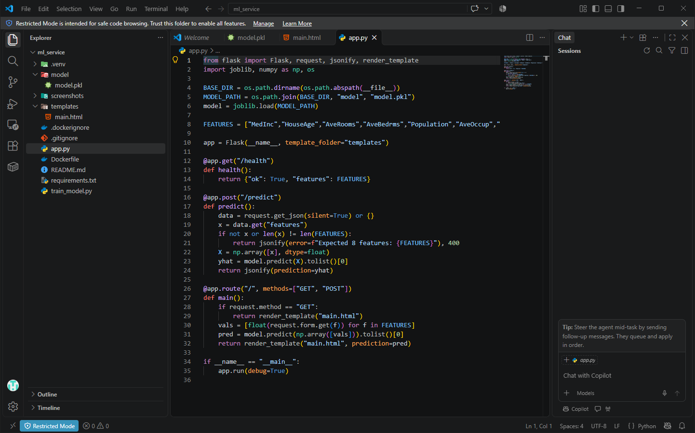
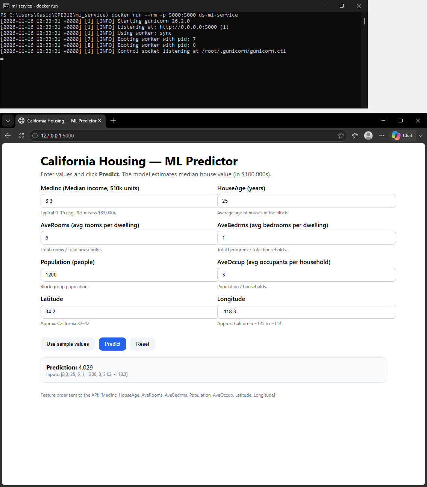
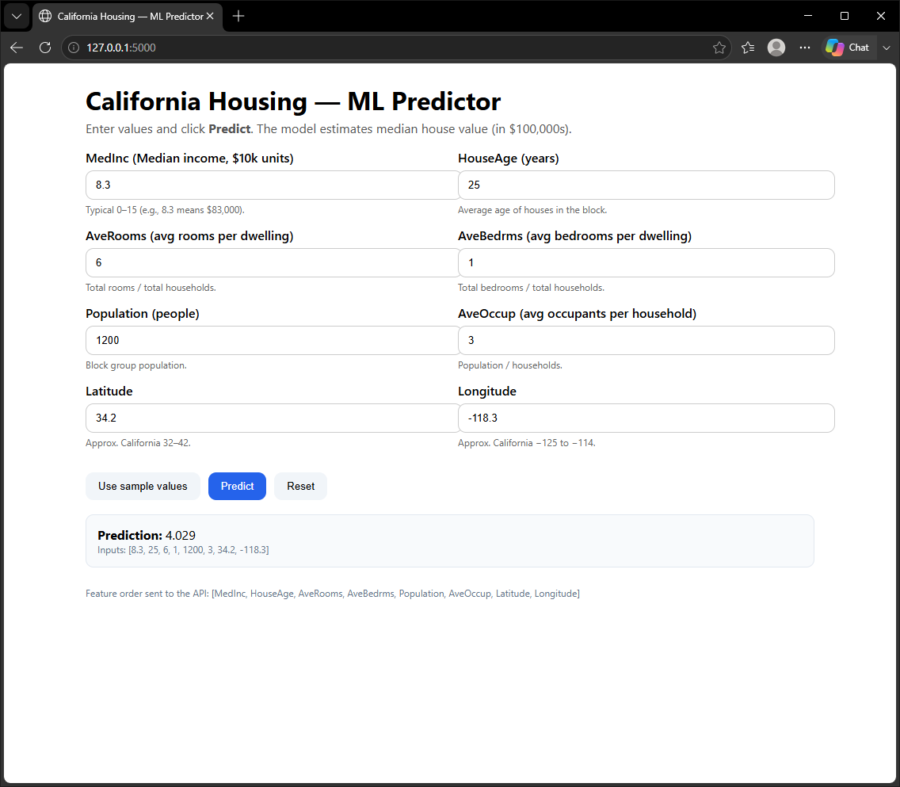
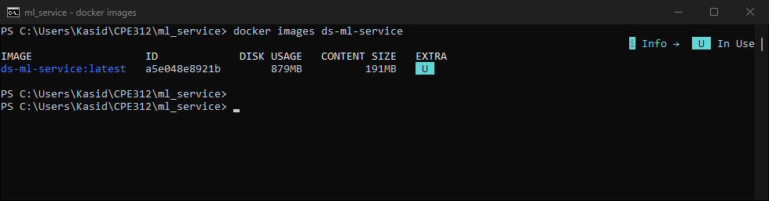
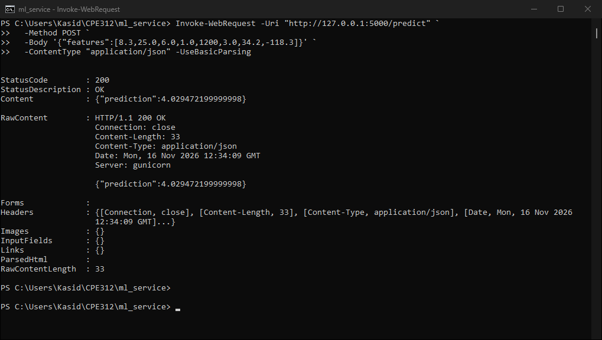
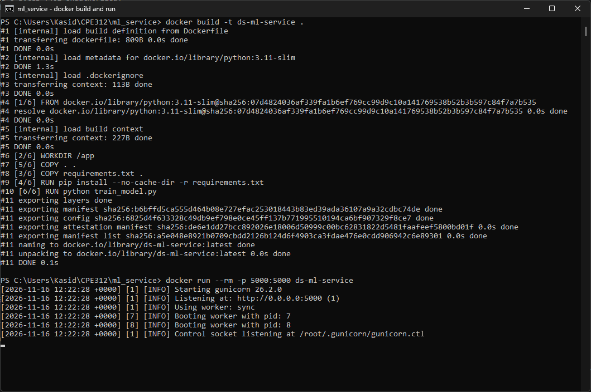
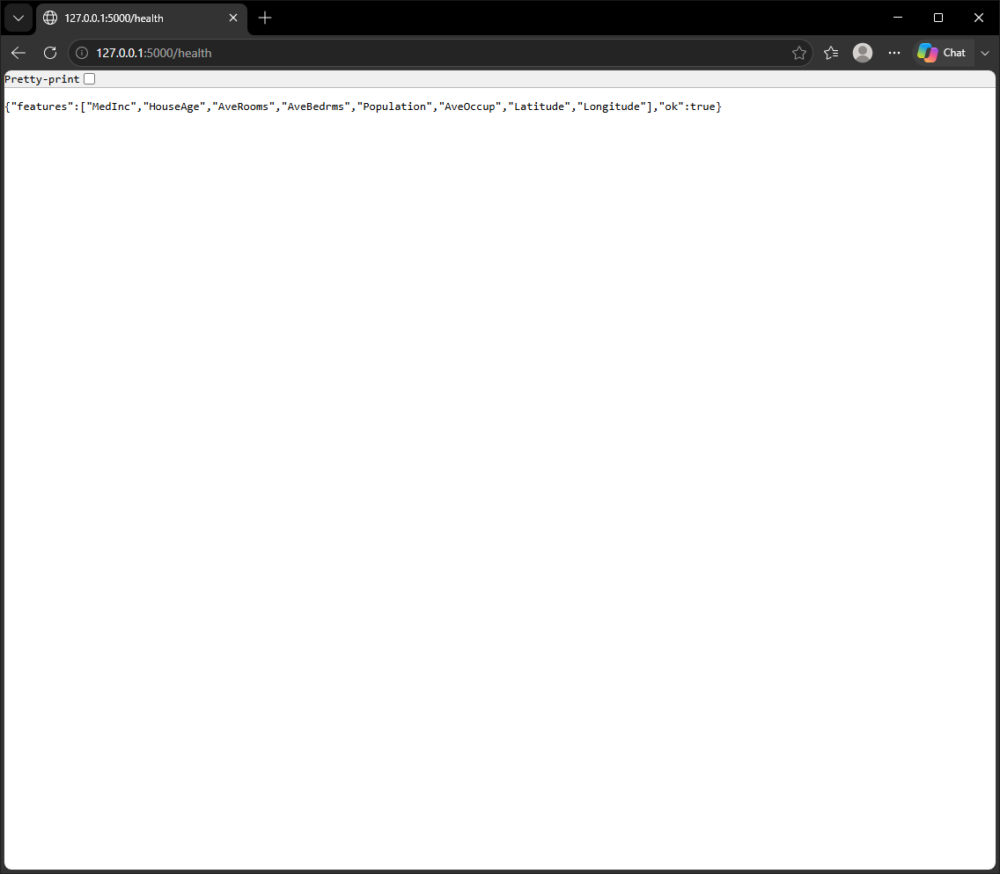

# Model as a Service ด้วย Flask และ Docker

Lab CPE312 Data Science — ให้บริการโมเดล Machine Learning (RandomForestRegressor ที่ฝึกด้วยชุดข้อมูล **California Housing**) ผ่านเว็บแอป Flask และรันใน Docker container

- หน้าเว็บ: `http://127.0.0.1:5000/` — กรอกค่า 8 ฟีเจอร์แล้วกด **Predict**
- ตรวจสอบสถานะ: `http://127.0.0.1:5000/health`
- API ทำนายผล: `POST http://127.0.0.1:5000/predict` (JSON)

---

## โครงสร้างโปรเจ็ค

```
ml_service/
├─ app.py              # Flask app: /, /health, /predict
├─ train_model.py      # ฝึกโมเดลและบันทึกเป็น model/model.pkl
├─ requirements.txt    # dependencies
├─ Dockerfile          # สร้าง image + train model ตอน build + รันด้วย gunicorn
├─ .dockerignore
├─ .gitignore          # ไม่ push model/ และ *.pkl ขึ้น GitHub
├─ templates/
│  └─ main.html        # หน้าเว็บสำหรับทดสอบ
├─ screenshots/        # ภาพหน้าจอผลการทดสอบ
└─ model/              # ถูกสร้างอัตโนมัติเมื่อรัน train_model.py
```

## ฟีเจอร์ที่โมเดลใช้ (เรียงตามลำดับ)

| # | Feature | ความหมาย |
|---|---------|----------|
| 1 | MedInc | รายได้มัธยฐาน (หน่วย $10,000) |
| 2 | HouseAge | อายุบ้านเฉลี่ย (ปี) |
| 3 | AveRooms | จำนวนห้องเฉลี่ยต่อครัวเรือน |
| 4 | AveBedrms | จำนวนห้องนอนเฉลี่ยต่อครัวเรือน |
| 5 | Population | จำนวนประชากรใน block |
| 6 | AveOccup | จำนวนผู้อยู่อาศัยเฉลี่ยต่อครัวเรือน |
| 7 | Latitude | ละติจูด |
| 8 | Longitude | ลองจิจูด |

ผลลัพธ์คือราคาบ้านมัธยฐาน หน่วย $100,000 (เช่น `4.03` ≈ $403,000)

---

## วิธี Build และ Run ด้วย Docker

ต้องติดตั้งและเปิด [Docker Desktop](https://www.docker.com/products/docker-desktop/) ก่อน

```powershell
# 1) clone โปรเจ็ค
git clone https://github.com/Qcutedev/ml-deployment-lab.git
cd ml-deployment-lab

# 2) build image (ขั้นตอนนี้จะติดตั้ง dependencies และ train model ให้อัตโนมัติ)
docker build -t ds-ml-service .

# 3) run container แล้ว map port 5000
docker run --rm -p 5000:5000 ds-ml-service
```

จากนั้นเปิดเบราว์เซอร์

- หน้าเว็บ: <http://127.0.0.1:5000/>
- ตรวจสอบสถานะ: <http://127.0.0.1:5000/health>

หยุด container ด้วย `Ctrl + C` ในหน้าต่างที่รัน `docker run`

> ถ้าพอร์ต 5000 ถูกใช้งานอยู่ ให้ใช้พอร์ตอื่น เช่น `docker run --rm -p 8080:5000 ds-ml-service` แล้วเข้า <http://127.0.0.1:8080/>

## ทดสอบ API `/predict`

PowerShell:

```powershell
Invoke-RestMethod -Uri http://127.0.0.1:5000/predict -Method Post -ContentType "application/json" -Body '{"features":[8.3,25.0,6.0,1.0,1200,3.0,34.2,-118.3]}'
```

curl:

```bash
curl -X POST http://127.0.0.1:5000/predict -H "Content-Type: application/json" -d '{"features":[8.3,25.0,6.0,1.0,1200,3.0,34.2,-118.3]}'
```

ผลลัพธ์ที่ได้:

```json
{"prediction": 4.029472199999998}
```

ถ้าส่งฟีเจอร์ไม่ครบ 8 ค่า API จะตอบกลับ HTTP 400 พร้อมข้อความ `Expected 8 features: [...]`

## (ทางเลือก) รันบนเครื่องโดยไม่ใช้ Docker

```powershell
python -m venv .venv
.venv\Scripts\activate
pip install -r requirements.txt
python train_model.py      # สร้าง model/model.pkl
python app.py              # เปิด http://127.0.0.1:5000/
```

---

## ผลการทดสอบ (Screenshots)

### 1. โครงสร้างไฟล์โปรเจ็ค



### 2. รัน container สำเร็จ (`Listening at: http://0.0.0.0:5000`) และหน้าเว็บแสดงผลการทำนาย

```powershell
docker run --rm -p 5000:5000 ds-ml-service
```



### 3. หน้าเว็บ <http://127.0.0.1:5000/> กรอกค่าทดสอบ แล้วกด Predict

กด **Use sample values** แล้วกด **Predict** ได้ `Prediction: 4.029`



### 4. Docker image

```powershell
docker images ds-ml-service
```



### 5. ทดสอบ API `/predict` ด้วย PowerShell (`Invoke-WebRequest`)

```powershell
Invoke-WebRequest -Uri "http://127.0.0.1:5000/predict" `
  -Method POST `
  -Body '{"features":[8.3,25.0,6.0,1.0,1200,3.0,34.2,-118.3]}' `
  -ContentType "application/json" -UseBasicParsing
```

> Windows PowerShell 5.1 จะถามยืนยันก่อนรัน `Invoke-WebRequest` ถ้าไม่ใส่ `-UseBasicParsing` (security prompt) ใส่ flag นี้แล้วผลลัพธ์เหมือนเดิม



### เพิ่มเติม: ผล `docker build` และหน้า `/health`





---

## ปัญหาที่พบบ่อย

| อาการ | วิธีแก้ |
|-------|---------|
| `gunicorn: not found` | เพิ่ม `gunicorn` ใน requirements.txt แล้ว build ใหม่ |
| `TemplateNotFound: main.html` | ตรวจสอบว่าไฟล์อยู่ใน `templates/` |
| `FileNotFoundError: model.pkl` | รัน `python train_model.py` ก่อน |
| `read-only file system` | ให้ไดรฟ์ C มีที่ว่างอย่างน้อย 5 GB แล้วรีสตาร์ท Docker |
| พอร์ต 5000 ถูกใช้งาน | ใช้ `-p 8080:5000` |
